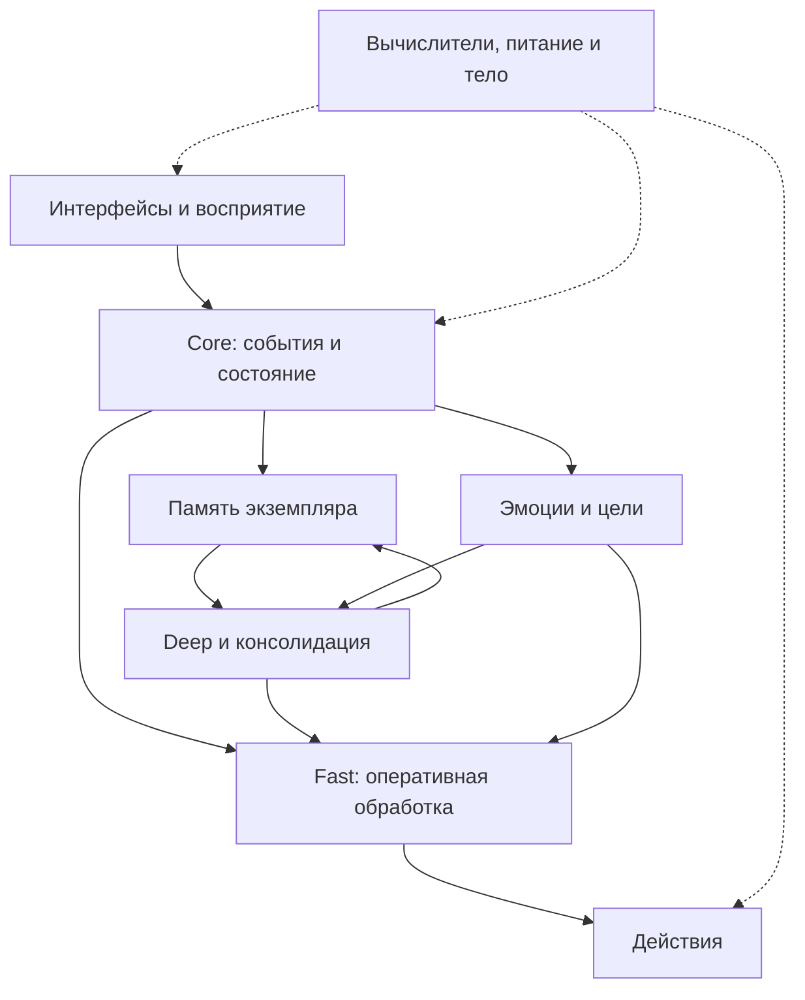

# Карта ANIMA

Карта показывает **целевую логическую структуру**. Она не означает, что все блоки уже реализованы. Реальное движение событий показано в [Event Pipeline](../03_SOFTWARE/Event_Pipeline.md).

## Верхний уровень

Сплошные стрелки обозначают проектные связи обработки, пунктир — аппаратное обеспечение. Конкретные сетевые протоколы и границы процессов пока Draft.

## Перейти к точному описанию

| Блок | Состав и описание |
|---|---|
| Core | [Состояние, события и идентичность](../02_ARCHITECTURE/Core.md) |
| Память | [Журнал, фильтр, отобранные записи, чтение и развитие памяти](../02_ARCHITECTURE/Memory.md) |
| Fast / Deep | [Две роли обработки и переносимый Fast](../02_ARCHITECTURE/Fast_Deep.md) |
| Эмоции и цели | [Эмоциональные оценки](../02_ARCHITECTURE/Emotions.md), [цели](../02_ARCHITECTURE/Goals.md) |
| Сон | [Консолидация и ограничения обучения](../02_ARCHITECTURE/Sleep.md) |
| Интерфейсы | [CLI, голос, инструменты и периферия](../02_ARCHITECTURE/Interfaces.md) |
| Железо | [Вычислители, носитель личности, питание, зрение, звук и движение](../04_HARDWARE/Hardware_Architecture.md) |

В [Module Index](Module_Index.md) каждый компонент имеет постоянный ID и два статуса. Описания могут объединять близкие модули на одной странице; ссылки ведут к конкретному разделу.

## Границы хранения

Исходный код и документация версионируются вместе. Опыт конкретного экземпляра находится в локальном data и резервируется отдельно. Разделение принято в [ADR-001](../08_DECISIONS/ADR-001-instance-continuity.md).

Аппаратное расположение логических модулей не закрепляется этой картой. Начальный прототип выполняется на одном компьютере; разнос на платы требует измерений и отдельного протокола.
