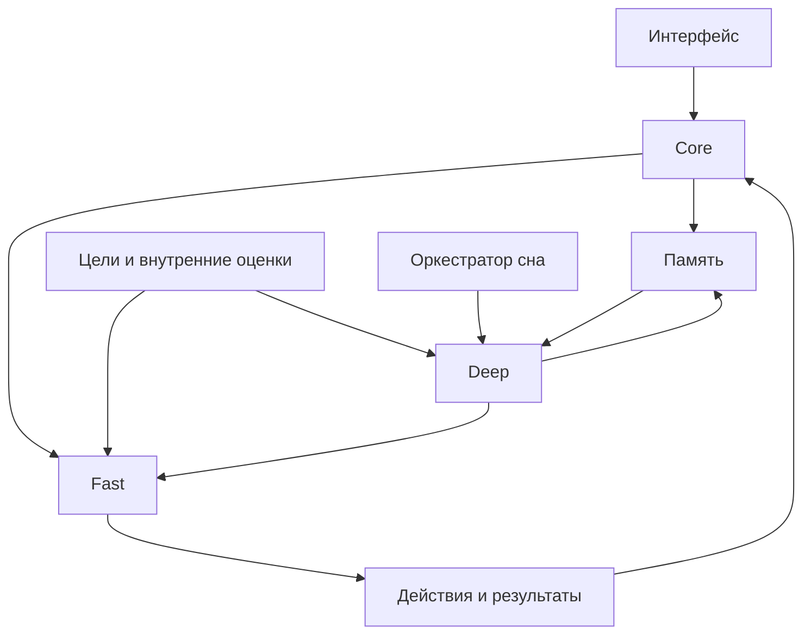

# Системная архитектура

Здесь разделены фактический прототип и целевое устройство. [System Map](../00_HOME/System_Map.md) — краткая навигационная карта; [Module Index](../00_HOME/Module_Index.md) — точный состав.

## Реализованный контур

main.py создаёт AnimaState, EventBus, EventLog, EpisodicMemory, MemoryFilter и MemoryStore. wake, один user_input и sleep обрабатываются последовательно в одном процессе. Хранение — локальные JSON/JSONL в data.

Нет моделей, маршрутизации, сетевой связи и фоновой обработки. Подробный порядок записи и обработки: [Event Pipeline](../03_SOFTWARE/Event_Pipeline.md).

## Целевая структура

Схема описывает проектные связи. Межмодульные сообщения, размещение процессов и способы синхронизации остаются Draft.

## Границы ответственности

| Подсистема | Отвечает за | Передаёт другим |
|---|---|---|
| Core | Состояние и идентификация, координация событий | События и текущее состояние |
| Memory | Хранение, происхождение и извлечение опыта | Релевантные записи |
| Fast | Быстрый контур | Ответ/действие, запрос Deep |
| Deep | Глубокая обработка | Анализ, план, новые выводы |
| Emotions / Goals | Оценки и явные цели | Факторы выбора действий |
| Sleep | Бюджет и порядок фоновых заданий | Задания и checkpoints |
| Interfaces | Ввод, вывод, действия | Наблюдаемый результат исполнения |

Точное описание входов/выходов каждого модуля доступно в [реестре](../00_HOME/Module_Index.md).

## Логический модуль и физическая плата

На первом шаге несколько подсистем могут работать на одном ноутбуке или Core-вычислителе. Каталог Python не определяет физическую границу. Отдельные платы — долгосрочное направление, которое требует измерений и контрактов.

Переносимый Fast должен уметь работать отдельно. Конкретная процедура обмена с Deep пока не реализована: [ADR-002](../08_DECISIONS/ADR-002-fast-deep.md).

## Открытые архитектурные вопросы

- Минимальная схема идентичности и происхождения записей.
- Единственный писатель данных и протоколы восстановления.
- Разрешение конфликтов offline Fast/Deep.
- Физическое размещение внутренних оценок и целей.
- Формат запросов моделей и критерии перехода к Deep.
- Граница между обновлением контекста и обучением модели.

Решения добавляются в [ADR](../08_DECISIONS/README.md); гипотезы — в [Experiments](../07_EXPERIMENTS/README.md).
