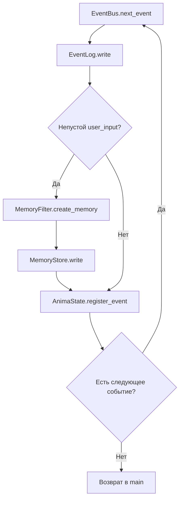

# Текущий конвейер событий

Исходный код: [main.py](../../main.py), EventBus и модули памяти. Этот порядок описывает реальную реализацию 00.1-alpha.

## Порядок обработки

Каждое вычитанное событие сначала проверяется и пишется в events.jsonl. Только выбранное событие дополнительно проверяется и пишется в memories.jsonl. Счётчик events_processed увеличивается после успешного завершения записей.

## Сессия

1. Создаются объекты хранения; AnimaState загружает или создаёт state.json.
2. wake() сохраняет awake, увеличивает session и обновляет last_wake.
3. Событие wake передаётся через конвейер.
4. CLI показывает состояние и последние выбранные воспоминания из memories.jsonl.
5. Если первый input получает Ctrl+C или EOF, put_to_sleep() сразу проводит событие sleep и сохраняет sleeping.
6. Обычная строка пользователя становится user_input и проходит через конвейер.
7. Второй input принимает Enter; Ctrl+C и EOF на этой точке также считаются контролируемым завершением.
8. put_to_sleep() проводит событие sleep через обычный конвейер, затем AnimaState.sleep() сохраняет sleeping.
9. Процесс завершается.

Ctrl+C/EOF перехватываются только вокруг операций ввода. Исключение или прерывание внутри обработки события не маскируется под штатное завершение.

Даты не имеют часового пояса. События разных запусков не имеют уникального ID.

## Форматы

| Хранилище | Поля | Содержание |
|---|---|---|
| events.jsonl | type, payload, timestamp | Все обработанные события |
| memories.jsonl | source, content, timestamp | Непустой пользовательский ввод |
| state.json | name, version, status, session и другие | Состояние экземпляра |

[Events](../05_PROTOCOLS/Events.md) содержит точную схему.

## Сбой между операциями

Записи в journal, selected memory и state не образуют единую транзакцию. Ошибка после journal может оставить событие в журнале без увеличения счётчика или выбранной записи. Очередь уже вычитана; автоматического повтора нет.

Повторное исполнение без ID может создать дубликат. Решение требует отдельного изменения и проверок, оно не включено в документационную работу.

## Чтение выбранной памяти

После SW-01 EpisodicMemory читает memories.jsonl по схеме source/content, а CLI показывает количество и последние выбранные воспоминания. Сырой events.jsonl остаётся отдельным журналом всех обработанных событий и не подменяется эпизодической памятью.

SW-05 завершена в commit 86f04b3: EOF и Ctrl+C на точках ввода завершают сессию через обычное событие sleep без потери уже обработанного ввода. Следующая задача Stage 0 — SW-06: явная конфигурация расположения данных. Подсистемы: [Core](../02_ARCHITECTURE/Core.md), [Memory](../02_ARCHITECTURE/Memory.md).
