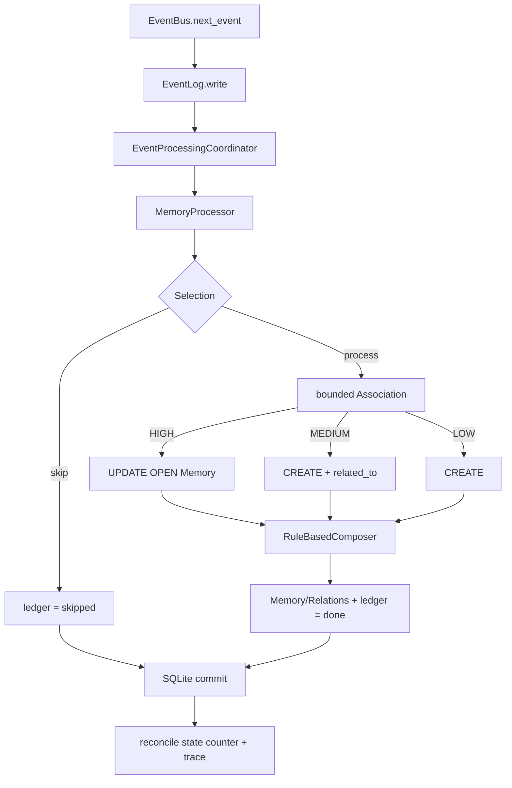

# Реализованная архитектура

Здесь описан только работающий и подтверждённый локальный Python-контур.
Будущие механизмы находятся в [Roadmap](../ROADMAP/README.md) и
[Research](../ROADMAP/Research.md). Принятый ADR или наличие таблицы в схеме сами
по себе не считаются реализацией.

## Компоненты и подтверждение

| Компонент | Код и граница ответственности | Проверки |
|---|---|---|
| Сборка и путь данных | [main](../../main.py) собирает зависимости; [paths](../../anima/config/paths.py) выбирает каталог данных | [cwd/внешний каталог](../../tests/test_data_directory.py), [CLI/headless](../../tests/test_d1_validation.py) |
| Runtime | [Runtime](../../anima/runtime.py): wake/user_input/sleep, Event processing и snapshot | [lifecycle](../../tests/test_runtime.py), [end-to-end](../../tests/test_d1_validation.py) |
| CLI и headless | [CLI](../../anima/interfaces/cli.py) владеет терминальным вводом; [ScenarioRunner](../../anima/scenario.py) выполняет сценарии без input() | [CLI session](../../tests/test_cli_session.py), [scenario](../../tests/test_scenario.py) |
| Идентичность и состояние | [Identity](../../anima/core/identity.py) хранит постоянный UUID4; [AnimaState](../../anima/core/state.py) сохраняет lifecycle/state | [state](../../tests/test_state.py), [recovery](../../tests/test_recovery.py) |
| Events | [Event/EventBus](../../anima/core/event_bus.py): `ev_` UUIDv4, hierarchical type, timestamp/source/session/references и FIFO | [Event Foundation](../../tests/test_events.py) |
| Raw Event Log | [EventLog](../../anima/memory/event_log.py): append-only JSONL, validation и duplicate-ID detection | [порядок/повреждения/reopen](../../tests/test_events.py), [restore](../../tests/test_recovery.py) |
| SQLite Memory Store | [MemoryStore](../../anima/memory/memory_store.py): schema v1, transactions, Memory CRUD/source links, indexes и FTS5 | [store/FTS/FK/rollback](../../tests/test_memory.py) |
| Memory read-view | [EpisodicMemory](../../anima/memory/episodic.py): `load/count/last` поверх того же MemoryStore | [reader view](../../tests/test_memory.py), [recovery](../../tests/test_recovery.py) |
| Entities / Relations | [LinkStore](../../anima/memory/link_store.py): Entity aliases, универсальные Relations и low-level Knowledge anchors | [relations/entity resolution](../../tests/test_provenance.py) |
| Provenance | [ProvenanceResolver](../../anima/memory/provenance.py): Memory/Relation/Knowledge/Entity → source Memory → raw Event | [provenance](../../tests/test_provenance.py) |
| Memory Processor | [MemoryProcessor](../../anima/memory/processor.py): Selection, bounded candidates, explainable Association и create/update/create_related | [association corpus](../../tests/test_memory_processor.py) |
| Event Processing / Recovery | [EventProcessingCoordinator](../../anima/memory/event_processing.py): persistent ledger, atomic Event effects, replay/retry/recovery и raw Event identity check | [event processing](../../tests/test_event_processing.py), [backup/restart](../../tests/test_recovery.py) |
| Memory Composer | [RuleBasedComposer](../../anima/memory/composer.py): deterministic bounded `content`, deduplication и conservative revision | [composer](../../tests/test_memory_composer.py), [revision](../../tests/test_memory_composer_revision.py) |
| Memory Lifecycle / History | [MemoryLifecycle](../../anima/memory/lifecycle.py): OPEN→CLOSED, Merge→MERGED и compact history | [lifecycle/merge/provenance](../../tests/test_memory_lifecycle.py) |
| Knowledge Layer | [KnowledgeLayer](../../anima/memory/knowledge.py): CLOSED evidence, provisional/confirmed/challenged/superseded/rejected lifecycle и history | [knowledge lifecycle](../../tests/test_knowledge.py), [evidence/state machine](../../tests/test_knowledge_evidence.py) |
| Retrieval | [RetrievalEngine](../../anima/memory/retrieval.py): exact ID, structured filters, Entity anchors, FTS5, 1-hop Relations и explainable ranking | [retrieval corpus](../../tests/test_retrieval.py) |
| Context Builder | [ContextBuilder](../../anima/memory/context_builder.py): FAST/DEEP read policies, exact/Knowledge/Memory priority, provenance Events и strict item/character budget | [context corpus](../../tests/test_context_builder.py) |
| Internal State Store / History | [InternalStateStore](../../anima/internal_state/store.py): `internal_state.db`, current values, causal transitions, Goals и source-operation ledger | [storage](../../tests/test_internal_state_storage.py), [history](../../tests/test_state_history.py) |
| State Variables / Transitions | [TransitionEngine](../../anima/internal_state/transition_engine.py) применяет bounded event/result rules к fatigue/uncertainty/frustration/satisfaction | [variables](../../tests/test_state_variables.py), [transition engine](../../tests/test_transition_engine.py) |
| Goals / Progress / Arbitration | [GoalStore](../../anima/internal_state/goals.py) хранит lifecycle; progress и arbitration отделяют verified result от порядка активных Goals | [goal model](../../tests/test_goal_model.py), [progress/arbitration](../../tests/test_goal_progress_arbitration.py) |
| Time Dynamics | [TimeDynamics](../../anima/internal_state/time_dynamics.py): lazy injected-time growth/recovery/decay без фонового tick | [time dynamics](../../tests/test_time_dynamics.py) |
| Choice Engine | [ChoiceEngine](../../anima/internal_state/choice_engine.py): read-only Candidate evaluation с bounded state modifiers и score trace | [choice](../../tests/test_choice_engine.py), [performance](../../tests/test_decision_performance.py) |
| Expression Adapter | [ExpressionAdapter](../../anima/internal_state/expression_adapter.py): read-only state → normalized ExpressionProfile | [expression](../../tests/test_expression_adapter.py) |
| Stage 2 Runtime / Recovery | [InternalStateRuntime](../../anima/internal_state/runtime_integration.py) собирает Goals/State/Choice/Expression; recovery journal завершает pending source operations | [runtime integration](../../tests/test_runtime_internal_state_integration.py), [recovery](../../tests/test_internal_state_recovery.py), [stage validation](../../tests/test_stage2_validation.py) |
| Наблюдаемость | [DiagnosticTrace](../../anima/diagnostics/trace.py) и [DiagnosticMetrics](../../anima/diagnostics/metrics.py) | [trace](../../tests/test_trace.py), [metrics](../../tests/test_metrics.py) |
| Изоляция тестов | [AnimaTestHarness](../../tests/harness.py) собирает Runtime во временном каталоге | [CLI/headless](../../tests/test_d1_validation.py) |

Показательные результаты: [TV-0004](../TESTING/Results/TV-0004.md),
[TV-0005](../TESTING/Results/TV-0005.md),
[TV-0006](../TESTING/Results/TV-0006.md),
[TV-0007](../TESTING/Results/TV-0007.md),
[TV-0008](../TESTING/Results/TV-0008.md),
[TV-0009](../TESTING/Results/TV-0009.md),
[TV-0010](../TESTING/Results/TV-0010.md),
[TV-0011](../TESTING/Results/TV-0011.md),
[TV-0012](../TESTING/Results/TV-0012.md),
[TV-0013](../TESTING/Results/TV-0013.md),
[TV-0014](../TESTING/Results/TV-0014.md),
[TV-0015](../TESTING/Results/TV-0015.md),
[TV-0016](../TESTING/Results/TV-0016.md),
[TV-0017](../TESTING/Results/TV-0017.md).

## Рабочий путь записи

Runtime создаёт Event и сначала пишет его в append-only `events.jsonl`.
`EventProcessingCoordinator` требует точного присутствия этой raw-записи, затем в
одной SQLite-транзакции переводит ledger в `processing`, вызывает
`MemoryProcessor` и фиксирует Memory/Relations вместе с final status `done` или
`skipped`. После commit Runtime согласует `state.json.events_processed` с числом
final ledger records.



JSONL Event и SQLite Memory сознательно не объединены одной общей транзакцией.
Разрыв закрывается recovery protocol: raw Event без ledger может быть принят или
повторён по определённым правилам, а SQLite effects и processing-status одного
Event являются атомарными между собой.

## Event Foundation

Event имеет обязательные поля `id`, `type`, `timestamp`, `source`, `session_id`,
`payload`, `references`. Public ID — `ev_` + UUIDv4; timestamp — ISO 8601 со
смещением. Тип — hierarchical lowercase name (`system.wake`,
`conversation.user`, `observation.visual`).

EventLog при reopen валидирует существующий журнал и восстанавливает ID set.
Malformed JSON, invalid Event и duplicate Event ID дают определённую ошибку.

## SQLite Memory Store

`memory.db` использует schema version 1 и `PRAGMA foreign_keys = ON`.
SQLite-транзакция делает commit только при полном успехе операции; исключение
вызывает rollback.

Основные таблицы:

- `memories`, `memory_sources`;
- `knowledge`;
- `entities`, `entity_aliases`;
- `relations`;
- `history`;
- `event_processing`;
- FTS5: `memory_fts`, `knowledge_fts`.

`knowledge_sources`, `memory_entities`, `knowledge_entities` остаются ранним
каркасом schema v1; канонические семантические связи уже хранятся в универсальной
`relations`. Их удаление/миграция не требуется до доказанной необходимости schema v2.

### Memory contract

Memory использует внутренний integer key и внешний `mem_<UUIDv4>`.
Поля: `type`, `domain`, `status`, `content`, `importance`, `created_at`,
`updated_at`, `closed_at`, `merged_into`.

Допустимые статусы: `open`, `closed`, `merged`. Runtime/Processor создаёт
`episodic/user/open`, importance=1. `memory_sources` связывает Memory с raw Event ID.

FTS5 индексирует `Memory.content`; triggers синхронизируют индекс при
insert/update/delete. Это baseline поиска, а не доказательство производительности.

## Entities, Relations и provenance

Entity — устойчивый якорь с canonical name, aliases и status. Resolution идёт
консервативно: exact canonical → exact alias → normalized match. Неоднозначность
не приводит к автоматическому merge.

Semantic links хранятся в одной `relations`:

- `about`;
- `related_to`, `continues`, `derived_from`;
- `supports`, `contradicts`, `investigates`;
- `supersedes`.

Каждая Relation обязана иметь `source_memory_id`, поэтому семантическая связь не
возникает без прослеживаемого Memory evidence. `ProvenanceResolver` проверяет
существование фактических source Events в `events.jsonl`, а не только наличие ID
в SQLite.

Подтверждённые цепочки включают:

```text
Memory → Event
Knowledge → supporting/contradicting Memory → Event
Relation → source Memory → Event
Entity → about Memory → Event
```

## Memory Processor

Selection Stage 1.4 обрабатывает непустой `conversation.user`; lifecycle Events и
пустой ввод пропускаются. Association не сравнивает Event со всей памятью:
берётся bounded набор OPEN episodic/user Memories и FTS candidates.

Explainable score использует domain/type, session, lexical overlap, Entity overlap
и близость времени. Сильное совпадение обновляет OPEN Memory; среднее создаёт
новую + `related_to`; слабое создаёт независимую Memory. Большой временной разрыв
блокирует UPDATE. Trace сохраняет action, score и reasons.

CLOSED/MERGED записи не используются как UPDATE candidates.

## Event Processing и Recovery

`EventProcessingCoordinator` использует ключ `(event_id, processor,
processor_version)` и статусы `pending/processing/done/failed/skipped`. Final
`done/skipped` Event при replay не запускает Memory effects повторно.

Перед processing проверяется, что Event уже присутствует в `events.jsonl` и его
полная raw-запись совпадает с переданным объектом. Ledger transition,
Memory create/update, `memory_sources`, Entity links и `related_to` одного Event
выполняются в одной SQLite-транзакции. Ошибка до commit откатывает эффекты, после
чего отдельная запись `failed` сохраняет attempts и last_error для retry.

При restart coordinator:

- принимает legacy raw Event как `done`, если его effect уже виден в
  `memory_sources`;
- принимает невыбранный lifecycle/empty Event как `skipped`;
- делает содержательный raw Event без effect `pending` и повторяет его;
- повторяет stale `processing/failed`;
- выдаёт ошибку, если ledger ссылается на отсутствующий raw Event.

Runtime после recovery восстанавливает `events_processed` по числу final ledger
records, поэтому crash после SQLite commit, но до записи `state.json`, не приводит
к повторному Memory effect.

## RuleBasedComposer

Composer отделён от Association: Processor решает **куда** писать, Composer —
**что** сохранять в `Memory.content`.

Baseline Composer:

- нормализует whitespace;
- удаляет точные повторы;
- имеет явный `max_chars` budget;
- при переполнении приоритизирует решения, результаты, изменения, ограничения,
  причины и открытые вопросы;
- может заменить короткий факт более полной формулировкой;
- допускает явную replacement-формулировку (`instead/вместо/replaced/заменили`).

Это deterministic baseline, а не полноценное семантическое суммаризирование.
Small/Deep Composer остаётся отложенным сравнительным механизмом.

## Memory Lifecycle и History

`MemoryLifecycle` реализует только явные операции:

- `OPEN → CLOSED`;
- `OPEN/CLOSED source → MERGED`, если target остаётся OPEN.

Merge требует одинаковые type/domain, запрещает self-merge и timestamp раньше
последнего изменения. Source не удаляется: он сохраняет свой `content`, собственные
source Event links, `status=merged` и `merged_into=<target>`.

Target получает недостающие source Event links и активные `about` Entity anchors.
Обе стороны Merge и close фиксируются в `history`; операция выполняется одной
SQLite-транзакцией. SPLIT намеренно не входит в Stage 1 baseline.

## Knowledge Layer

`KnowledgeLayer` не вызывается автоматически из Memory Processor: существование
Memory само по себе не делает утверждение знанием. Новый candidate создаётся только
из CLOSED source Memory и получает `supports` Relation с provenance.

Подтверждённый lifecycle:

```text
provisional → confirmed → challenged → confirmed
                                  ├→ superseded
                                  └→ rejected
```

Investigation хранится отдельной Relation и не меняет статус Knowledge. Challenge
требует CLOSED contradicting Memory; reconfirm после challenge требует нового
supporting evidence. Одна и та же Memory не может одновременно поддерживать и
противоречить одному Knowledge.

Supersession не переписывает старое утверждение: создаётся новая confirmed
Knowledge, старая становится `superseded`, а между ними создаётся Relation
`supersedes`. `superseded` и `rejected` являются терминальными состояниями для
новых investigation branches. Переходы и существенные evidence changes пишутся в
`history`; provenance продолжает проходить до raw Events.

## Retrieval

`RetrievalEngine` является read-only слоем поверх MemoryStore/LinkStore. Он
объединяет дешёвые и объяснимые сигналы в фиксированном baseline:

1. exact `mem_` / `kn_` ID;
2. structured filters по domain/type/status;
3. Entity ID/alias через `about`;
4. FTS5 по `Memory.content` и `Knowledge.statement`;
5. максимум один hop по Relations;
6. deterministic ranking и `top_k`.

Каждый результат содержит `kind`, `id`, `score`, `reasons`, `record`. Exact ID
имеет наибольший вес; current Knowledge status и Memory importance дают только
ограниченные bonuses. `importance` не заменяет relevance.

Обычный current-search по умолчанию исключает `merged` Memories и
`superseded/rejected` Knowledge. История не удаляется: terminal records доступны
через exact ID или явный status filter. Deep traversal, embeddings, semantic/LLM
rerank и query expansion в этот baseline не входят.

## Context Builder

`ContextBuilder` является read-only слоем поверх Retrieval/Provenance и формирует
структурированный `ContextBundle`: query, consumer, budget, `knowledge[]`,
`memories[]`, `events[]`, `truncated` и selection statistics.

FAST использует узкую выборку без raw Events; DEEP разрешает один relation hop и
добавляет deduplicated provenance Events. Exact-ID result имеет первый приоритет,
после него обычная выборка предпочитает Knowledge перед Memories, а Events идут
последними. Каждый объект сохраняет score/selection reason.

`max_items` и `max_chars` являются жёсткими budget: запись, которая не помещается
целиком, не обрезается, а пропускается с `truncated=true`. Token-aware budgets и
model-specific policies отложены до появления конкретного model consumer.

## Internal State, Goals и Choice

Stage 2 добавляет отдельный регулирующий контур в `internal_state.db`. Он не заменяет
lifecycle `state.json` и не смешивается с `memory.db`. Основные данные: `state_values`,
`state_transitions`, `goals`, `goal_transitions` и `source_operations` для replay-safe
мутаций.

Четыре baseline state — `fatigue`, `uncertainty`, `frustration`, `satisfaction` —
ограничены диапазоном `0.0..1.0`. Любое содержательное изменение проходит через
причинный transition `before + delta → after` с source/rule/reason и optional
Goal/Candidate context. Arbitrary public setter отсутствует.

Goal имеет lifecycle `active/blocked/completed/cancelled`. Progress и success
принимаются только через явный `GoalObservation`; success требует проверенного
результата и выполненного criterion. Arbitration выбирает только среди active Goals
по внешнему priority и не разрешает Internal State менять authority цели.

Choice получает уже существующий active Goal и список Candidates:

```text
Goal + Candidates
       ↓
base score
       +
bounded Internal State modifiers
       ↓
ranked Choice + score trace
```

`fatigue` штрафует effort, `uncertainty` повышает information gain и штрафует
irreversible risk, `frustration` штрафует repeated failure и поддерживает alternative,
`satisfaction` даёт меньший бонус verified continuation. Choice read-only и не создаёт
Goal/Candidate.

Time dynamics вычисляется лениво по injected elapsed time. Fatigue растёт по awake
period и workload, recovery снижает fatigue; frustration возвращается к baseline,
satisfaction decay к baseline, uncertainty не меняется только из-за времени. Это
исключает зависимость результата от частоты фонового tick.

Expression Adapter является односторонним read-only отображением state в
`energy/caution/tension/positive_affect`; скрытого feedback `Expression → State` нет.
Raw Event не получает автоматической эмоциональной интерпретации: Runtime принимает
явные `StateSignal`/`GoalObservation`, чтобы семантическая причина оставалась видимой.

Persistent `source_operations` journal делает state signals, goal observations и
source-backed Goal creation идемпотентными. После crash Runtime достраивает pending
операцию, не начисляя уже существующий `source_id + rule_id` effect повторно.

## Stage 1 validation и performance baseline

Финальный Stage 1 corpus содержит 37 raw Events в 11 сессиях и проходит через
restart/replay, Memory/Relations, CLOSED evidence, Knowledge supersession,
Retrieval, FAST/DEEP Context и provenance до исходных Events. Результат подтверждён
[TV-0014](../TESTING/Results/TV-0014.md).

Performance baseline [TV-0015](../TESTING/Results/TV-0015.md) измеряет 1k/10k/100k
синтетических записей без заданного SLA. На 100k Event append остаётся около
15.5k/s, Memory CRUD/lookup и 1-hop — около 1 ms, FTS — около 10 ms p95,
Retrieval — около 119 ms p95, FAST Context — около 118 ms p95. Полный data-каталог
занимает около 152 MB, peak RSS процесса достиг 265 MB.

Измерены два существенных bottleneck: production EventProcessing batch падает до
0.41 events/s на 100k, а DEEP Context достигает около 23.4 s p95. Текущий
coordinator для каждого Event линейно перечитывает raw Event log при identity
check; provenance при каждом выбранном объекте заново строит полный Event index.
Baseline сохранён до оптимизации, чтобы последующие изменения сравнивались с
фактическими исходными числами.

## Stage 2 validation и performance baseline

Stage 2 завершён на snapshot `36c8d65`: 13 canonical validation tests прошли вместе
с полным regression suite `306 passed`; результат зафиксирован в
[TV-0017](../TESTING/Results/TV-0017.md). Проверка связывает Goals, четыре state,
Choice, time, Expression, ScenarioRunner и restart/replay через существующие Runtime
границы.

Decision baseline [TV-0016](../TESTING/Results/TV-0016.md) показывает для 100
Candidates p95 0.0211 ms на base ranking, 0.0993 ms на state modifiers и 2.0092 ms
на production Choice с полным trace/history. Python allocation peak полного режима
составил 273.101 KiB. Process peak RSS сохраняется только как high-water mark worker
и не трактуется как per-choice allocation.

## Каталог и контракты данных

По умолчанию данные находятся в `<project>/data`; `ANIMA_DATA_DIR` задаёт другой
каталог.

| Файл | Контракт |
|---|---|
| `identity.json` | schema_version, постоянный instance_id, created_at |
| `state.json` | lifecycle/status/session/timestamps/events_processed |
| `events.jsonl` | append-only raw Events |
| `memory.db` | SQLite Cognitive Memory storage |
| `internal_state.db` | SQLite Internal State, Goals, causal history и source recovery ledger |

Backup/restore копирует весь data-каталог. После восстановления продолжаются
identity, session/event history, Cognitive Memory и Internal State/Goal history.
Старый `memories.jsonl` больше не является рабочим форматом и не мигрируется.

## Подтверждённые ограничения

- EventBus FIFO остаётся RAM-only; persistent queue/ack отсутствуют.
- JSONL append и SQLite commit не образуют одну физическую транзакцию; recovery
  protocol закрывает этот разрыв на уровне обработки, но не делает файлы атомарными.
- Автоматические правила закрытия/merge Memory ещё не реализованы; lifecycle
  вызывается явно.
- Автоматическое создание/принятие Knowledge моделью не реализовано; lifecycle
  вызывается явно на подтверждённом evidence.
- EventProcessing raw identity check и DEEP provenance используют повторные полные
  сканирования `events.jsonl`; на 100k это даёт 0.41 batch events/s и около 23.4 s
  p95 DEEP Context. Оптимизация отложена после фиксации baseline.
- Raw Events не преобразуются автоматически в StateSignal/GoalObservation; смысл
  должен быть задан явным consumer до Stage 4 Agent semantics.
- Internal State не создаёт Goals/Candidates. Planner, self-generated goals и
  authority policy отсутствуют; Candidates задаёт внешний consumer/scenario.
- ExpressionProfile пока не привязан к конкретному text/voice/UI renderer, а fatigue
  не использует реальные CPU/GPU/power signals.
- Sleep consolidation, Deep/LLM Composer, embeddings, vector/graph DB и distributed
  memory не реализованы; Sleep consolidation является текущей задачей Stage 3.
