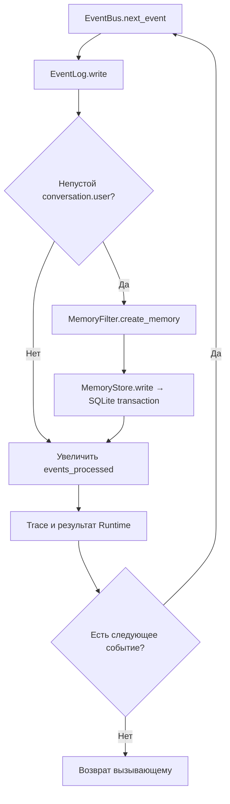

# Реализованная архитектура

Здесь описан работающий локальный Python-контур. Будущие механизмы находятся в
[Roadmap](../ROADMAP/README.md) и [исследованиях](../ROADMAP/Research.md).
Архитектура и реализация объединены: каждая строка ведёт к исходнику и проверке.

## Компоненты и подтверждение

| Компонент | Код и граница ответственности | Проверки |
|---|---|---|
| Сборка и путь данных | [main](../../main.py) собирает зависимости; [paths](../../anima/config/paths.py) выбирает каталог | [cwd и внешний каталог](../../tests/test_data_directory.py), [CLI/headless](../../tests/test_d1_validation.py) |
| Runtime | [Runtime](../../anima/runtime.py): wake/user_input/sleep, session_id для Events, обработка событий, snapshot | [lifecycle](../../tests/test_runtime.py), [end-to-end](../../tests/test_d1_validation.py) |
| Headless | [ScenarioRunner](../../anima/scenario.py): список шагов без input(), результат каждого шага | [сценарии и ошибки](../../tests/test_scenario.py) |
| CLI | [run_cli](../../anima/interfaces/cli.py): ввод/вывод и штатные EOF/Ctrl+C | [прерывания](../../tests/test_cli_session.py), [эквивалентность](../../tests/test_d1_validation.py) |
| Идентичность | [Identity](../../anima/core/identity.py): новый UUID4 или загрузка существующего | [ID при переносе](../../tests/test_data_directory.py), [ID в snapshot](../../tests/test_runtime.py) |
| Состояние | [AnimaState](../../anima/core/state.py): lifecycle, проверка структуры, временный файл и os.replace | [валидация и сохранение](../../tests/test_state.py), [recovery](../../tests/test_recovery.py) |
| События | [Event/EventBus](../../anima/core/event_bus.py): `ev_` UUIDv4, hierarchical type, timezone-aware timestamp, source/session/references и FIFO | [schema/валидация/ID/references](../../tests/test_events.py) |
| Сырой журнал | [EventLog](../../anima/memory/event_log.py): append-only JSONL, валидация и duplicate-ID detection при write/reopen | [порядок/повреждения/дубликаты/reopen](../../tests/test_events.py), [история после restore](../../tests/test_recovery.py) |
| SQLite Memory Store | [MemoryStore](../../anima/memory/memory_store.py): schema v1, transactions, Memory CRUD, source links, indexes и FTS5 | [schema/CRUD/reopen/rollback/constraints/FTS/FK](../../tests/test_memory.py) |
| Чтение памяти | [EpisodicMemory](../../anima/memory/episodic.py): совместимый read-view `load/count/last` над MemoryStore | [reader view](../../tests/test_memory.py), [restore](../../tests/test_recovery.py) |
| Временный отбор памяти | [MemoryFilter](../../anima/memory/filter.py): непустой `conversation.user` → простая episodic Memory | [Runtime/D1 integration](../../tests/test_d1_validation.py) |
| Наблюдаемость | [DiagnosticTrace](../../anima/diagnostics/trace.py): записи/строки; [DiagnosticMetrics](../../anima/diagnostics/metrics.py): длительности и process resources | [trace](../../tests/test_trace.py), [metrics/snapshot](../../tests/test_metrics.py) |
| Изоляция проверок | [AnimaTestHarness](../../tests/harness.py) собирает Runtime во временном каталоге | [CLI/headless](../../tests/test_d1_validation.py) |

Показательные проверки: [Event Foundation TV-0004](../TESTING/Results/TV-0004.md)
и [SQLite Memory Store TV-0005](../TESTING/Results/TV-0005.md).

## Жизненный цикл и запись

`main.py` создаёт один `MemoryStore(data/memory.db)` и передаёт его Runtime/CLI.
`wake()` создаёт `system.wake`, `user_input(text)` — `conversation.user`, `sleep()` —
`system.sleep`. Runtime добавляет активный `session_XXXXXXXX`, записывает каждый
Event в append-only `events.jsonl`, а временный MemoryFilter отбирает только
непустой пользовательский ввод.

JSONL Event и SQLite Memory сознательно не являются одной общей транзакцией.
Persistent `event_processing` и безопасный retry относятся к Stage 1.10.

## Event Foundation

Event имеет обязательные поля `id`, `type`, `timestamp`, `source`, `session_id`,
`payload`, `references`. Public ID — `ev_` + canonical UUIDv4. Новый timestamp
создаётся в UTC и обязан быть ISO 8601 со смещением.

Тип события — hierarchical lowercase name минимум из двух сегментов, например
`system.wake`, `conversation.user`, `observation.visual`. Lifecycle Events требуют
null payload; `conversation.user` — объект со строковым `text`; остальные типы
допускают JSON-serializable payload. `references` — список `{kind, id}`.

EventLog при reopen валидирует существующий журнал и восстанавливает ID set.
Duplicate ID, malformed JSON и invalid Event дают определённую ошибку.

## SQLite Memory Store

`memory.db` имеет `schema_version = 1`. Соединения включают
`PRAGMA foreign_keys = ON`; инициализация не принимает неизвестную версию схемы
или невалидный SQLite-файл. Записи изменяются через явный transaction context:
успех делает commit, исключение — rollback.

### Реализованные таблицы

- `schema_meta`;
- `memories`, `memory_sources`;
- `knowledge`, `knowledge_sources`;
- `entities`, `entity_aliases`;
- `memory_entities`, `knowledge_entities`;
- `relations`;
- `history`;
- `event_processing`;
- FTS5 virtual tables `memory_fts`, `knowledge_fts`.

На Stage 1.2 поведенчески реализован именно Memory слой. Таблицы Knowledge,
Entities, Relations, History и event_processing пока являются подготовленным
каркасом следующих шагов и сами по себе не доказывают их функциональность.

### Memory contract

`memories` использует внутренний `INTEGER PRIMARY KEY` и внешний
`mem_<UUIDv4>`. Поля: `type`, `domain`, `status`, `content`, `importance`,
`created_at`, `updated_at`, `closed_at`, `merged_into`.

Допустимо:

- type: `episodic`, `procedural`;
- domain: `self`, `user`, `project`, `environment`, `system`;
- status: `open`, `closed`, `merged`;
- importance: целое `0..3`.

Runtime на текущем переходном шаге создаёт `episodic/user/open`, importance=1.
`MemoryFilter` превращает текст `conversation.user` в строковый `content` и
передаёт его `event_id` как `source_event_id`. `MemoryStore.write()` создаёт
Memory и связь в `memory_sources` одной SQLite-транзакцией.

MemoryStore предоставляет `create_memory`, `get_memory`, `list_memories`,
`count`, `last`, `source_events`, `update_memory`, `delete_memory` и
`search_memories`. `EpisodicMemory` больше не владеет отдельным файлом: это тонкий
read-view над тем же Store для сохранения существующего Runtime/CLI interface.

### FTS и индексы

FTS5 индексирует `Memory.content` и `Knowledge.statement`. SQLite triggers
синхронизируют FTS при insert/update/delete. `search_memories()` использует MATCH,
`bm25` и limit. На Memory есть индексы status/domain/type/created_at; source Event
индексируется отдельно. Остальные таблицы также получили baseline indexes для
будущих запросов Stage 1.

Это функциональный baseline, а не доказательство оптимальной производительности.
Benchmark и решение об оптимизации относятся к Stage 1.12.

## Каталог и контракты данных

По умолчанию каталог — `<project>/data`; `ANIMA_DATA_DIR` задаёт другой путь.
Файлы экземпляра резервируются отдельно от Git.

| Файл | Фактический контракт |
|---|---|
| `identity.json` | schema_version, instance_id, created_at; UUID4 |
| `state.json` | lifecycle/status/session/timestamps/events_processed |
| `events.jsonl` | append-only Events: `ev_<UUIDv4>`, type, timestamp, source, session_id, payload, references |
| `memory.db` | SQLite schema v1; Cognitive Memory storage baseline |

`memories.jsonl` больше не является частью рабочего Runtime и не мигрируется.
Старые тестовые данные были признаны неценными; compatibility import отсутствует.

## Recovery и подтверждённые свойства

Backup/restore копирует весь data-каталог, включая `memory.db`. После восстановления
следующая сессия продолжает Event history, а Memory Store повторно открывает
существующую SQLite-базу. D1 CLI/headless остаются эквивалентны после замены
JSONL-memory на SQLite.

Локальная проверка Stage 1.2 на Python 3.14.4: полный suite `84 passed`; отдельный
Memory Store suite `8 passed`. Подробности и ограничения — [TV-0005](../TESTING/Results/TV-0005.md).

## Подтверждённые границы и ограничения

- EventBus FIFO остаётся RAM-only; persistent queue и acknowledgement отсутствуют.
- EventLog и `memory.db` не являются одной атомарной транзакцией.
- `event_processing` пока только таблица схемы; pending/processing/retry ещё не реализованы.
- `memory_sources` хранит `event_id`, но SQLite не может foreign-key ссылаться на
  append-only JSONL. Существование source Event пока обеспечивается приложением и тестами.
- Memory lifecycle поля существуют, но полные правила OPEN/CLOSED/MERGED и Merge
  относятся к Stage 1.6.
- Entity aliases, Relations semantics и полный provenance реализуются в Stage 1.3.
- Knowledge lifecycle реализуется в Stage 1.7.
- FTS5 уже работает как baseline, но полный Retrieval/ranking относится к Stage 1.8.
- MemoryFilter остаётся временным простым адаптером; Association/Processor и
  Composer появятся в Stage 1.4–1.5.
- Производительность на 1k/10k/100k ещё не измерялась; оптимизация не выполнялась.
- Модели, embeddings, vector/graph DB, Sleep consolidation и distributed memory
  остаются отложенными механизмами.

Механизм переносится сюда из планов после реализации и подтверждения сценариями.
Принятый ADR сам по себе не доказывает готовность.
