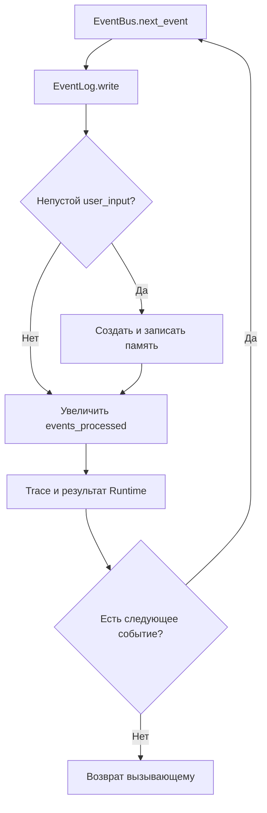

# Реализованная архитектура

Здесь описан работающий локальный Python-контур. Будущие механизмы находятся в
[Roadmap](../ROADMAP/README.md) и [исследованиях](../ROADMAP/Research.md).
Архитектура и реализация объединены: каждая строка ведёт к исходнику и проверке.

## Компоненты и подтверждение

| Компонент | Код и граница ответственности | Проверки |
|---|---|---|
| Сборка и путь данных | [main](../../main.py) собирает зависимости; [paths](../../anima/config/paths.py) выбирает каталог | [cwd и внешний каталог](../../tests/test_data_directory.py), [CLI/headless](../../tests/test_d1_validation.py) |
| Runtime | [Runtime](../../anima/runtime.py): wake/user_input/sleep, обработка событий, snapshot | [lifecycle](../../tests/test_runtime.py), [end-to-end](../../tests/test_d1_validation.py) |
| Headless | [ScenarioRunner](../../anima/scenario.py): список шагов без input(), результат каждого шага | [сценарии и ошибки](../../tests/test_scenario.py) |
| CLI | [run_cli](../../anima/interfaces/cli.py): ввод/вывод и штатные EOF/Ctrl+C | [прерывания](../../tests/test_cli_session.py), [эквивалентность](../../tests/test_d1_validation.py) |
| Идентичность | [Identity](../../anima/core/identity.py): новый UUID4 или загрузка существующего | [ID при переносе](../../tests/test_data_directory.py), [ID в snapshot](../../tests/test_runtime.py) |
| Состояние | [AnimaState](../../anima/core/state.py): lifecycle, проверка структуры, временный файл и os.replace | [валидация и сохранение](../../tests/test_state.py), [recovery](../../tests/test_recovery.py) |
| События | [Event/EventBus](../../anima/core/event_bus.py): проверяемый Event и FIFO в памяти процесса | [тип/payload/порядок](../../tests/test_events.py) |
| Сырой журнал | [EventLog](../../anima/memory/event_log.py): все обработанные события в JSONL | [контракт](../../tests/test_events.py), [история после restore](../../tests/test_recovery.py) |
| Выбор и запись памяти | [MemoryFilter](../../anima/memory/filter.py) отбирает непустой ввод; [MemoryStore](../../anima/memory/memory_store.py) валидирует и дописывает запись | [отбор и ошибки](../../tests/test_memory.py) |
| Чтение памяти | [EpisodicMemory](../../anima/memory/episodic.py): load/count/last по memories.jsonl | [чтение и повреждения](../../tests/test_memory.py), [restore](../../tests/test_recovery.py) |
| Наблюдаемость | [DiagnosticTrace](../../anima/diagnostics/trace.py): записи/строки; [DiagnosticMetrics](../../anima/diagnostics/metrics.py): длительности и process resources | [trace](../../tests/test_trace.py), [metrics/snapshot](../../tests/test_metrics.py) |
| Изоляция проверок | [AnimaTestHarness](../../tests/harness.py) собирает Runtime во временном каталоге | [два независимых экземпляра](../../tests/test_d1_validation.py) |

Существование code/tests проверяется автоматически; поведение подтверждается
запуском pytest. Таблица не утверждает полное покрытие всех возможных отказов.

## Жизненный цикл и запись

main.py создаёт объекты; CLI или ScenarioRunner вызывает один Runtime.
wake() сначала сохраняет awake, увеличивает session и записывает last_wake,
затем создаёт wake. user_input(text) передаёт текст. sleep() обрабатывает событие
sleep и сохраняет sleeping; повторный sleep в sleeping пропускается с записью в trace.



Порядок: raw journal → выбранная memory, если нужна → сохранение счётчика → trace.
CLI показывает состояние и последние три выбранных воспоминания, принимает одну
строку и ожидает Enter для сна. EOF/Ctrl+C вокруг обеих операций input() завершают
сессию через Runtime.sleep(); ошибки внутри обработки события не маскируются под сон.

ScenarioRunner принимает непустой список словарей с action wake/user_input/sleep;
user_input требует строковый text. Возвращает action и типы созданных events;
ValueError дополняется индексом шага. Event валидируется до добавления в FIFO.

## Каталог и контракты данных

По умолчанию каталог — `<project>/data`; ANIMA_DATA_DIR задаёт другой путь.
Относительный путь разрешается от корня проекта, `~` раскрывается, пустое значение
даёт ошибку. Код anima/memory — часть проекта; файлы экземпляра резервируются
отдельно ([процедура](../OPERATIONS/README.md#резервирование)).

| Файл | Поля и фактический контракт |
|---|---|
| identity.json | schema_version, instance_id, created_at; при создании schema_version=1, UUID4; существующий JSON загружается без полной проверки схемы |
| state.json | name, version, status, session, created_at, last_wake, last_sleep, events_processed; статусы created/awake/sleeping; счётчики — целые ≥0, bool не допускается |
| events.jsonl | type, payload, timestamp; wake/sleep требуют null payload; user_input — объект со строковым text; timestamp — непустая строка |
| memories.jsonl | source="user_input", timestamp — непустая строка, content — объект со строковым text; writer/reader используют общий validate_memory_record |

Синтетические примеры:

```json
{"type":"user_input","payload":{"text":"Проверка ANIMA"},"timestamp":"2026-10-12T12:00:00"}
```

```json
{"source":"user_input","timestamp":"2026-10-12T12:00:00","content":{"text":"Проверка ANIMA"}}
```

Фильтр проверяет text.strip(), но сохраняет исходный payload с пробелами. Это
отбор по непустоте. JSONL читается целиком; пустые строки пропускаются, отсутствие
файла даёт пустой список; повреждение сообщает файл и номер строки.
last(limit=5) возвращает хвост выбранной памяти. Времена локальные без UTC offset.
Версия берётся из кода в сводке [О проекте](../../README.md#состояние).

## Диагностика

Runtime.snapshot() возвращает identity, поля state, memory.count и diagnostics.metrics.
Trace хранит timestamp/message в RAM, доступен как entries()/lines(), допускает clear().
Metrics измеряет успешные lifecycle-операции через perf_counter; getrusage(RUSAGE_SELF)
возвращает cpu_user_seconds, cpu_system_seconds, max_rss_kb. На Linux max RSS —
KiB и пик процесса, не текущая RAM отдельной операции; единицы/доступность resource
зависят от платформы. Trace/timings не записываются в data автоматически.
Наблюдение процесса — [команда теста](../TESTING/README.md#наблюдать-процесс).

## Подтверждённые границы и ограничения

- FIFO только в RAM одного процесса: нет persistent queue, event_id,
  acknowledgement, лимита и межпоточной синхронизации.
- Events/memory/state не образуют транзакцию. Ошибка после raw append оставляет
  неполный результат; событие уже снято с очереди, retry нет; повтор без IDs
  может дублировать запись.
- Атомарность state не даёт атомарность всем файлам. Повреждённый state/JSONL
  останавливает чтение; автоматической миграции/ремонта нет. get() возвращает
  изменяемую ссылку; валидация времени ограничена типами.
- Для identity нужны валидация, безопасная запись и правила конкурирующих копий.
  Одинаковый ID у копий не выбирает единственное продолжение экземпляра.
- Модели, тематический retrieval, внутренние оценки, когнитивная консолидация,
  инструменты, сеть и аппаратный прототип отсутствуют. Событие sleep завершает
  сессию и не выполняет фоновое обучение.

Механизм переносится сюда из планов после реализации и подтверждения сценариями.
Принятый ADR сам по себе не доказывает готовность.
