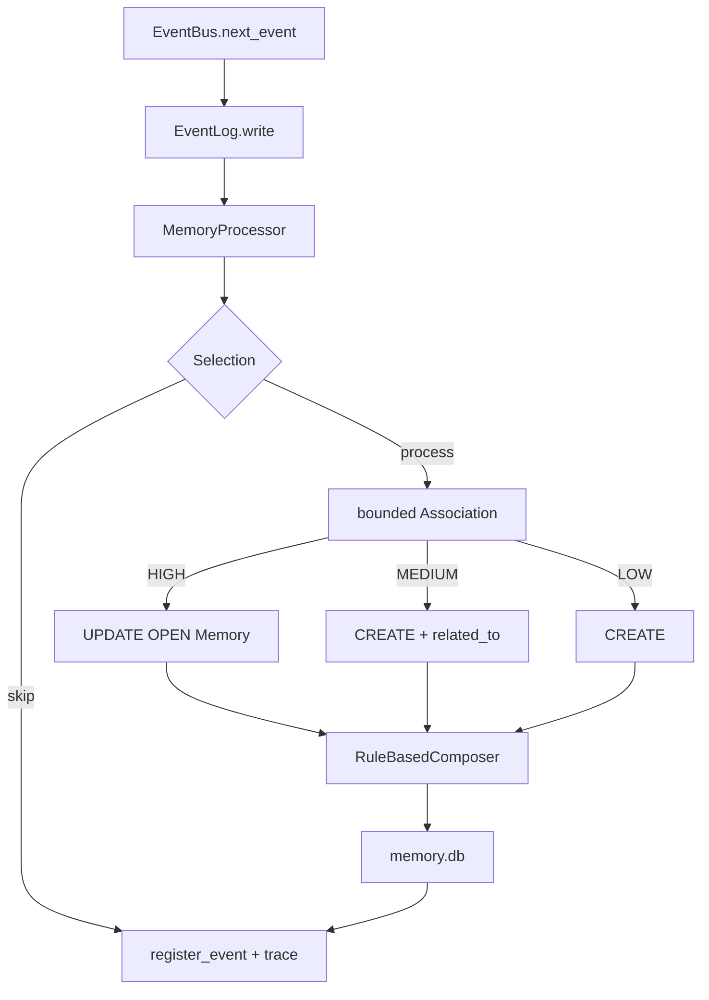

# Реализованная архитектура

Здесь описан только работающий и подтверждённый локальный Python-контур.
Будущие механизмы находятся в [Roadmap](../ROADMAP/README.md) и
[Research](../ROADMAP/Research.md). Принятый ADR или наличие таблицы в схеме сами
по себе не считаются реализацией.

## Компоненты и подтверждение

| Компонент | Код и граница ответственности | Проверки |
|---|---|---|
| Сборка и путь данных | [main](../../main.py) собирает зависимости; [paths](../../anima/config/paths.py) выбирает каталог данных | [cwd/внешний каталог](../../tests/test_data_directory.py), [CLI/headless](../../tests/test_d1_validation.py) |
| Runtime | [Runtime](../../anima/runtime.py): wake/user_input/sleep, Event processing и snapshot | [lifecycle](../../tests/test_runtime.py), [end-to-end](../../tests/test_d1_validation.py) |
| CLI и headless | [CLI](../../anima/interfaces/cli.py) владеет терминальным вводом; [ScenarioRunner](../../anima/scenario.py) выполняет сценарии без input() | [CLI session](../../tests/test_cli_session.py), [scenario](../../tests/test_scenario.py) |
| Идентичность и состояние | [Identity](../../anima/core/identity.py) хранит постоянный UUID4; [AnimaState](../../anima/core/state.py) сохраняет lifecycle/state | [state](../../tests/test_state.py), [recovery](../../tests/test_recovery.py) |
| Events | [Event/EventBus](../../anima/core/event_bus.py): `ev_` UUIDv4, hierarchical type, timestamp/source/session/references и FIFO | [Event Foundation](../../tests/test_events.py) |
| Raw Event Log | [EventLog](../../anima/memory/event_log.py): append-only JSONL, validation и duplicate-ID detection | [порядок/повреждения/reopen](../../tests/test_events.py), [restore](../../tests/test_recovery.py) |
| SQLite Memory Store | [MemoryStore](../../anima/memory/memory_store.py): schema v1, transactions, Memory CRUD/source links, indexes и FTS5 | [store/FTS/FK/rollback](../../tests/test_memory.py) |
| Memory read-view | [EpisodicMemory](../../anima/memory/episodic.py): `load/count/last` поверх того же MemoryStore | [reader view](../../tests/test_memory.py), [recovery](../../tests/test_recovery.py) |
| Entities / Relations | [LinkStore](../../anima/memory/link_store.py): Entity aliases, универсальные Relations и low-level Knowledge anchors | [relations/entity resolution](../../tests/test_provenance.py) |
| Provenance | [ProvenanceResolver](../../anima/memory/provenance.py): Memory/Relation/Knowledge/Entity → source Memory → raw Event | [provenance](../../tests/test_provenance.py) |
| Memory Processor | [MemoryProcessor](../../anima/memory/processor.py): Selection, bounded candidates, explainable Association и create/update/create_related | [association corpus](../../tests/test_memory_processor.py) |
| Memory Composer | [RuleBasedComposer](../../anima/memory/composer.py): deterministic bounded `content`, deduplication и conservative revision | [composer](../../tests/test_memory_composer.py), [revision](../../tests/test_memory_composer_revision.py) |
| Memory Lifecycle / History | [MemoryLifecycle](../../anima/memory/lifecycle.py): OPEN→CLOSED, Merge→MERGED и compact history | [lifecycle/merge/provenance](../../tests/test_memory_lifecycle.py) |
| Наблюдаемость | [DiagnosticTrace](../../anima/diagnostics/trace.py) и [DiagnosticMetrics](../../anima/diagnostics/metrics.py) | [trace](../../tests/test_trace.py), [metrics](../../tests/test_metrics.py) |
| Изоляция тестов | [AnimaTestHarness](../../tests/harness.py) собирает Runtime во временном каталоге | [CLI/headless](../../tests/test_d1_validation.py) |

Показательные результаты: [TV-0004](../TESTING/Results/TV-0004.md),
[TV-0005](../TESTING/Results/TV-0005.md),
[TV-0006](../TESTING/Results/TV-0006.md),
[TV-0007](../TESTING/Results/TV-0007.md),
[TV-0008](../TESTING/Results/TV-0008.md),
[TV-0009](../TESTING/Results/TV-0009.md).

## Рабочий путь записи

Runtime создаёт Events и всегда сначала пишет их в append-only `events.jsonl`.
Затем `MemoryProcessor` выполняет Selection и Association. Для содержательных
`conversation.user` он либо создаёт новую Memory, либо обновляет OPEN-эпизод, либо
создаёт новую связанную Memory. Формирование `content` вынесено в отдельный
Composer.



JSONL Event и SQLite Memory сознательно не объединены одной общей транзакцией.
Persistent `event_processing`/retry относится к Stage 1.10.

## Event Foundation

Event имеет обязательные поля `id`, `type`, `timestamp`, `source`, `session_id`,
`payload`, `references`. Public ID — `ev_` + UUIDv4; timestamp — ISO 8601 со
смещением. Тип — hierarchical lowercase name (`system.wake`,
`conversation.user`, `observation.visual`).

EventLog при reopen валидирует существующий журнал и восстанавливает ID set.
Malformed JSON, invalid Event и duplicate Event ID дают определённую ошибку.

## SQLite Memory Store

`memory.db` использует schema version 1 и `PRAGMA foreign_keys = ON`.
SQLite-транзакция делает commit только при полном успехе операции; исключение
вызывает rollback.

Основные таблицы:

- `memories`, `memory_sources`;
- `knowledge`;
- `entities`, `entity_aliases`;
- `relations`;
- `history`;
- `event_processing`;
- FTS5: `memory_fts`, `knowledge_fts`.

`knowledge_sources`, `memory_entities`, `knowledge_entities` остаются ранним
каркасом schema v1; канонические семантические связи уже хранятся в универсальной
`relations`. Их удаление/миграция не требуется до доказанной необходимости schema v2.

### Memory contract

Memory использует внутренний integer key и внешний `mem_<UUIDv4>`.
Поля: `type`, `domain`, `status`, `content`, `importance`, `created_at`,
`updated_at`, `closed_at`, `merged_into`.

Допустимые статусы: `open`, `closed`, `merged`. Runtime/Processor создаёт
`episodic/user/open`, importance=1. `memory_sources` связывает Memory с raw Event ID.

FTS5 индексирует `Memory.content`; triggers синхронизируют индекс при
insert/update/delete. Это baseline поиска, а не доказательство производительности.

## Entities, Relations и provenance

Entity — устойчивый якорь с canonical name, aliases и status. Resolution идёт
консервативно: exact canonical → exact alias → normalized match. Неоднозначность
не приводит к автоматическому merge.

Semantic links хранятся в одной `relations`:

- `about`;
- `related_to`, `continues`, `derived_from`;
- `supports`, `contradicts`, `investigates`;
- `supersedes`.

Каждая Relation обязана иметь `source_memory_id`, поэтому семантическая связь не
возникает без прослеживаемого Memory evidence. `ProvenanceResolver` проверяет
существование фактических source Events в `events.jsonl`, а не только наличие ID
в SQLite.

Подтверждённые цепочки включают:

```text
Memory → Event
Knowledge → supporting/contradicting Memory → Event
Relation → source Memory → Event
Entity → about Memory → Event
```

## Memory Processor

Selection Stage 1.4 обрабатывает непустой `conversation.user`; lifecycle Events и
пустой ввод пропускаются. Association не сравнивает Event со всей памятью:
берётся bounded набор OPEN episodic/user Memories и FTS candidates.

Explainable score использует domain/type, session, lexical overlap, Entity overlap
и близость времени. Сильное совпадение обновляет OPEN Memory; среднее создаёт
новую + `related_to`; слабое создаёт независимую Memory. Большой временной разрыв
блокирует UPDATE. Trace сохраняет action, score и reasons.

CLOSED/MERGED записи не используются как UPDATE candidates.

## RuleBasedComposer

Composer отделён от Association: Processor решает **куда** писать, Composer —
**что** сохранять в `Memory.content`.

Baseline Composer:

- нормализует whitespace;
- удаляет точные повторы;
- имеет явный `max_chars` budget;
- при переполнении приоритизирует решения, результаты, изменения, ограничения,
  причины и открытые вопросы;
- может заменить короткий факт более полной формулировкой;
- допускает явную replacement-формулировку (`instead/вместо/replaced/заменили`).

Это deterministic baseline, а не полноценное семантическое суммаризирование.
Small/Deep Composer остаётся отложенным сравнительным механизмом.

## Memory Lifecycle и History

`MemoryLifecycle` реализует только явные операции:

- `OPEN → CLOSED`;
- `OPEN/CLOSED source → MERGED`, если target остаётся OPEN.

Merge требует одинаковые type/domain, запрещает self-merge и timestamp раньше
последнего изменения. Source не удаляется: он сохраняет свой `content`, собственные
source Event links, `status=merged` и `merged_into=<target>`.

Target получает недостающие source Event links и активные `about` Entity anchors.
Обе стороны Merge и close фиксируются в `history`; операция выполняется одной
SQLite-транзакцией. SPLIT намеренно не входит в Stage 1 baseline.

## Каталог данных и recovery

По умолчанию данные находятся в `<project>/data`; `ANIMA_DATA_DIR` задаёт другой
каталог.

| Файл | Контракт |
|---|---|
| `identity.json` | schema_version, постоянный instance_id, created_at |
| `state.json` | lifecycle/status/session/timestamps/events_processed |
| `events.jsonl` | append-only raw Events |
| `memory.db` | SQLite Cognitive Memory storage |

Backup/restore копирует весь data-каталог. После восстановления продолжаются
identity, session/event history и SQLite Memory Store. Старый `memories.jsonl`
больше не является рабочим форматом и не мигрируется.

## Подтверждённые ограничения

- EventBus FIFO остаётся RAM-only; persistent queue/ack отсутствуют.
- JSONL и SQLite не образуют одну атомарную транзакцию.
- `event_processing` пока только schema-каркас; idempotent retry — Stage 1.10.
- Автоматические правила закрытия/merge Memory ещё не реализованы; lifecycle
  вызывается явно.
- Knowledge anchors и Relations существуют, но **полный Knowledge lifecycle**
  `provisional/confirmed/challenged/superseded/rejected` относится к текущему
  Stage 1.7 и не считается реализованным до отдельной зелёной проверки.
- Общий Retrieval/ranking — Stage 1.8; Context Builder — Stage 1.9.
- Производительность 1k/10k/100k ещё не измерялась; оптимизация не выполнялась.
- LLM/Deep Composer, embeddings, vector/graph DB, Sleep consolidation и
  distributed memory остаются отложенными механизмами.
