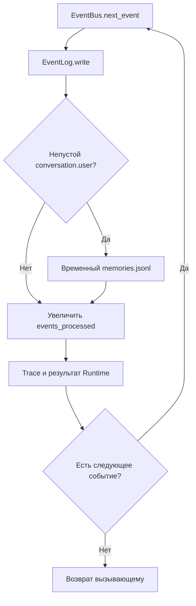

# Реализованная архитектура

Здесь описан работающий локальный Python-контур. Будущие механизмы находятся в
[Roadmap](../ROADMAP/README.md) и [исследованиях](../ROADMAP/Research.md).
Архитектура и реализация объединены: каждая строка ведёт к исходнику и проверке.

## Компоненты и подтверждение

| Компонент | Код и граница ответственности | Проверки |
|---|---|---|
| Сборка и путь данных | [main](../../main.py) собирает зависимости; [paths](../../anima/config/paths.py) выбирает каталог | [cwd и внешний каталог](../../tests/test_data_directory.py), [CLI/headless](../../tests/test_d1_validation.py) |
| Runtime | [Runtime](../../anima/runtime.py): wake/user_input/sleep, session_id для Events, обработка событий, snapshot | [lifecycle](../../tests/test_runtime.py), [end-to-end](../../tests/test_d1_validation.py) |
| Headless | [ScenarioRunner](../../anima/scenario.py): список шагов без input(), результат каждого шага | [сценарии и ошибки](../../tests/test_scenario.py) |
| CLI | [run_cli](../../anima/interfaces/cli.py): ввод/вывод и штатные EOF/Ctrl+C | [прерывания](../../tests/test_cli_session.py), [эквивалентность](../../tests/test_d1_validation.py) |
| Идентичность | [Identity](../../anima/core/identity.py): новый UUID4 или загрузка существующего | [ID при переносе](../../tests/test_data_directory.py), [ID в snapshot](../../tests/test_runtime.py) |
| Состояние | [AnimaState](../../anima/core/state.py): lifecycle, проверка структуры, временный файл и os.replace | [валидация и сохранение](../../tests/test_state.py), [recovery](../../tests/test_recovery.py) |
| События | [Event/EventBus](../../anima/core/event_bus.py): `ev_` UUIDv4, иерархический type, UTC-offset timestamp, source/session/references и FIFO | [schema/валидация/ID/references](../../tests/test_events.py) |
| Сырой журнал | [EventLog](../../anima/memory/event_log.py): append-only JSONL, валидация и duplicate-ID detection при write/reopen | [порядок/повреждения/дубликаты/reopen](../../tests/test_events.py), [история после restore](../../tests/test_recovery.py) |
| Временный выбор и запись памяти | [MemoryFilter](../../anima/memory/filter.py) отбирает непустой `conversation.user`; [MemoryStore](../../anima/memory/memory_store.py) дописывает legacy JSONL до Stage 1.2 | [отбор и ошибки](../../tests/test_memory.py), [интеграция](../../tests/test_runtime.py) |
| Временное чтение памяти | [EpisodicMemory](../../anima/memory/episodic.py): load/count/last по `memories.jsonl` до SQLite Store | [чтение и повреждения](../../tests/test_memory.py), [restore](../../tests/test_recovery.py) |
| Наблюдаемость | [DiagnosticTrace](../../anima/diagnostics/trace.py): записи/строки; [DiagnosticMetrics](../../anima/diagnostics/metrics.py): длительности и process resources | [trace](../../tests/test_trace.py), [metrics/snapshot](../../tests/test_metrics.py) |
| Изоляция проверок | [AnimaTestHarness](../../tests/harness.py) собирает Runtime во временном каталоге | [два независимых экземпляра](../../tests/test_d1_validation.py) |

Существование code/tests проверяется автоматически; поведение подтверждается
запуском pytest. Показательная проверка Event Foundation —
[TV-0004](../TESTING/Results/TV-0004.md). Таблица не утверждает полное покрытие
всех возможных отказов.

## Жизненный цикл и запись

main.py создаёт объекты; CLI или ScenarioRunner вызывает один Runtime.
`wake()` сначала сохраняет `awake`, увеличивает session и записывает last_wake,
затем создаёт `system.wake`. `user_input(text)` создаёт `conversation.user`.
`sleep()` обрабатывает `system.sleep` и сохраняет `sleeping`; повторный sleep в
sleeping пропускается с записью в trace. Runtime переводит номер активной сессии
в строковый `session_00000001`-подобный идентификатор и добавляет его к Events.



Порядок пока остаётся Foundation/D1: raw journal → временная selected memory, если
нужна → сохранение счётчика → trace. SQLite Memory Store и transaction обработки
появятся в Stage 1.2 и последующих шагах.

CLI показывает состояние и последние три выбранных воспоминания, принимает одну
строку и ожидает Enter для сна. EOF/Ctrl+C вокруг обеих операций input() завершают
сессию через Runtime.sleep(); ошибки внутри обработки события не маскируются под сон.

ScenarioRunner принимает непустой список словарей с action wake/user_input/sleep;
user_input требует строковый text. Возвращает action и фактические иерархические
типы созданных Events; ValueError дополняется индексом шага. Event полностью
валидируется до добавления в FIFO.

## Event Foundation

Event имеет обязательные поля `id`, `type`, `timestamp`, `source`, `session_id`,
`payload`, `references`. Public ID — `ev_` + canonical UUIDv4. Новый timestamp
создаётся в UTC и обязан быть ISO 8601 со смещением; записи без timezone отвергаются.
`source` — непустая строка, `session_id` — непустая строка либо null.

Тип события — иерархическое lowercase-имя минимум из двух сегментов, например
`system.wake`, `conversation.user`, `observation.visual`. Для `system.wake` и
`system.sleep` payload обязан быть null; для `conversation.user` — объект со
строковым `text`. Другие типы допускают произвольный JSON-serializable payload,
что позволяет расширять словарь событий без списка Python-классов на каждый тип.
NaN/Infinity и не-JSON значения не допускаются.

`references` — список объектов строго вида `{kind, id}` с непустыми строками.
На Stage 1.1 это структурированные ссылки без проверки существования целевого
Asset/Memory/другого объекта; referential integrity появится вместе с соответствующим
storage. Event копирует reference-словари после валидации.

EventLog перед append валидирует Event и держит известные IDs текущего журнала.
При создании над существующим `events.jsonl` он перечитывает файл, валидирует все
строки и восстанавливает ID set. Duplicate ID при записи или внутри существующего
файла считается ошибкой; malformed JSON и invalid Event сообщают номер строки.
Пустые строки пропускаются. Это защита истории, но ещё не persistent processing queue.

## Каталог и контракты данных

По умолчанию каталог — `<project>/data`; ANIMA_DATA_DIR задаёт другой путь.
Относительный путь разрешается от корня проекта, `~` раскрывается, пустое значение
даёт ошибку. Код anima/memory — часть проекта; файлы экземпляра резервируются
отдельно ([процедура](../OPERATIONS/README.md#резервирование)).

| Файл | Поля и фактический контракт |
|---|---|
| identity.json | schema_version, instance_id, created_at; при создании schema_version=1, UUID4; существующий JSON загружается без полной проверки схемы |
| state.json | name, version, status, session, created_at, last_wake, last_sleep, events_processed; статусы created/awake/sleeping; счётчики — целые ≥0, bool не допускается |
| events.jsonl | id=`ev_<UUIDv4>`, hierarchical type, ISO 8601 timestamp с UTC offset, source, session_id, payload, references; запись строго валидируется, duplicate IDs запрещены |
| memories.jsonl | временный Stage 0/D1 storage: source=`conversation.user`, timestamp — непустая строка, content — объект со строковым text; будет заменён `memory.db` в Stage 1.2 |

Синтетический Event:

```json
{"id":"ev_550e8400-e29b-41d4-a716-446655440000","type":"conversation.user","timestamp":"2026-10-26T11:35:47+00:00","source":"user","session_id":"session_00000001","payload":{"text":"Проверка ANIMA"},"references":[]}
```

Временная selected memory:

```json
{"source":"conversation.user","timestamp":"2026-10-26T11:35:47+00:00","content":{"text":"Проверка ANIMA"}}
```

MemoryFilter проверяет `text.strip()`, но сохраняет исходный payload с пробелами.
Это старый простой отбор по непустоте, а не Stage 1 Memory Processor. JSONL memory
читается целиком; отсутствие файла даёт пустой список, повреждение сообщает файл
и номер строки. `last(limit=5)` возвращает хвост выбранной памяти.

Event timestamps теперь timezone-aware; времена `state.json` пока используют
прежний локальный формат и будут унифицироваться только при отдельной необходимости.
Версия берётся из кода в сводке [О проекте](../../README.md#состояние).

## Диагностика

Runtime.snapshot() возвращает identity, поля state, memory.count и diagnostics.metrics.
Trace хранит timestamp/message в RAM, доступен как entries()/lines(), допускает clear().
Metrics измеряет успешные lifecycle-операции через perf_counter; getrusage(RUSAGE_SELF)
возвращает cpu_user_seconds, cpu_system_seconds, max_rss_kb. На Linux max RSS —
KiB и пик процесса, не текущая RAM отдельной операции; единицы/доступность resource
зависят от платформы. Trace/timings не записываются в data автоматически.
Наблюдение процесса — [команда теста](../TESTING/README.md#наблюдать-процесс).

## Подтверждённые границы и ограничения

- FIFO остаётся только в RAM одного процесса: нет persistent queue,
  acknowledgement, лимита и межпоточной синхронизации.
- `event_id` и duplicate detection уже есть, но состояния `pending/processing/done`
  и безопасного retry ещё нет; это отдельная работа Stage 1.10.
- Events/memory/state не образуют транзакцию. Ошибка после raw append может оставить
  неполный downstream-результат; SQLite transaction появится для Memory Store,
  но JSONL и SQLite сознательно не будут общей атомарной транзакцией.
- `references` сейчас валидируются структурно, но существование цели не проверяется.
- Атомарность state не даёт атомарность всем файлам. Повреждённый state/JSONL
  останавливает чтение; автоматической миграции/ремонта нет. get() возвращает
  изменяемую ссылку. Времена state ещё не приведены к Event timestamp contract.
- `memories.jsonl`, MemoryFilter и EpisodicMemory — переходный compatibility слой;
  они не являются новой Cognitive Memory и должны исчезнуть после Stage 1.2.
- Для identity нужны валидация, безопасная запись и правила конкурирующих копий.
  Одинаковый ID у копий не выбирает единственное продолжение экземпляра.
- Knowledge, Entities/Relations storage, тематический retrieval, Context Builder,
  внутренние оценки, когнитивная консолидация, инструменты, сеть и аппаратный
  прототип отсутствуют. `system.sleep` завершает сессию и не выполняет обучение.

Механизм переносится сюда из планов после реализации и подтверждения сценариями.
Принятый ADR сам по себе не доказывает готовность.
